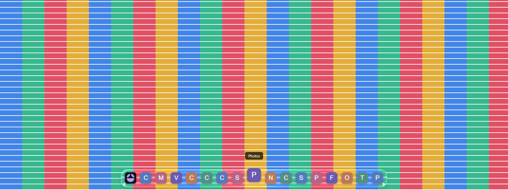
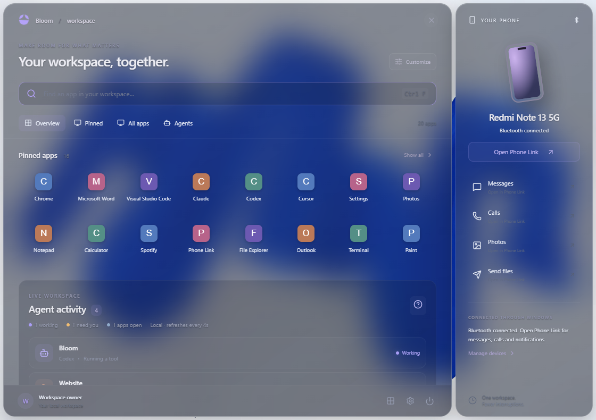
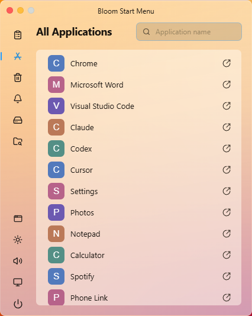
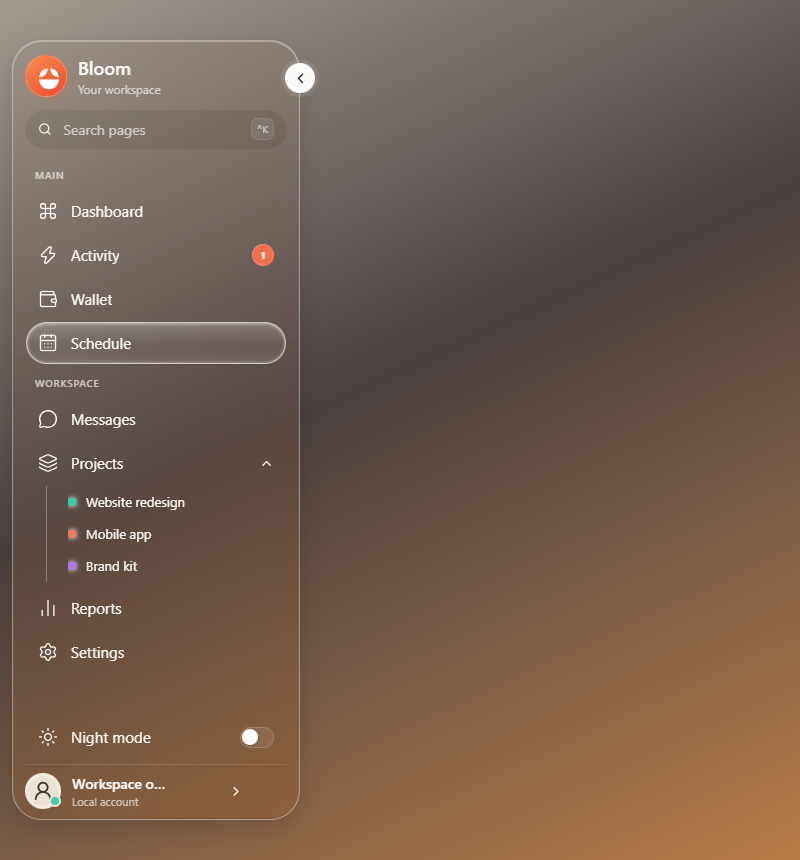
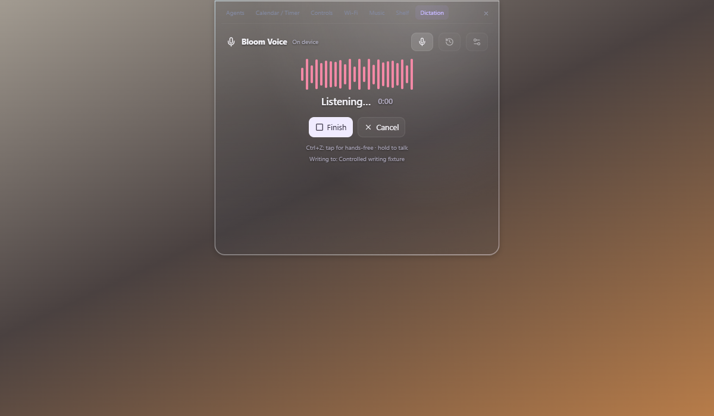

<div align="center">

# Bloom Mac Dock for Windows

A see-through dock, a compact top notch and a frosted Start menu for Windows.


<div align="left">  

## Features

- Built-in local Voice dictation in the notch. Tap or hold Ctrl+Z; editable transcripts, original-window insertion, local history and dictionary/snippet rules. Change/disable the shortcut to retain Undo.
- Glass sidebar with left/right placement, smart overlap hiding, edge reveal, compact/expanded navigation, real app search, agent activity, project folders, local tasks, expenses, reports and Phone Link routing.

- Optional GPU-rendered dock glass with desktop/window scene sampling, refraction, diffusion, reflection and pointer lighting.
- Up to 65 pins. Drag to reorder; pins and their exact order persist across restarts.
- Chrome installed web apps retain their own icons, launch arguments, profiles and window identities.
- A top notch with clock, local AI-agent activity, calendar, timer, media, Wi-Fi, audio, brightness, Bluetooth, shelf and Windows quick controls.
- Independent dock and notch Liquid Glass switches in Settings → Appearance; choices persist across restarts.
- MacOS Start: compact warm frosted launcher matching the supplied reference, with working app search, sidebar shortcuts, agents and power controls.
- Glassmorphism Bloom Start: frosted panels, search, independent pins, categories, recent apps, agent overview and Phone Link routing.
- Lock, Sleep, Shut down and Restart in Start's power menu.
- Normal Windows title-bar buttons without global traffic-light overlays. MacOS Start uses local header controls matching its reference.
- Launch at Windows sign-in with saved dock, notch and Start preferences, and a persistent opt-out in General settings.
- Clicking running apps focuses their existing windows without launching duplicate browser tabs.

## Preview

These screenshots use isolated fixtures with sample apps, not private desktop sessions.







Voice uses whisper.cpp and Whisper base locally, with a checksum-verified first-run engine download (approximately 150 MB). It is an independent implementation, not Wispr’s proprietary AI backend. See [Voice and sidebar details](VOICE-AND-SIDEBAR.md).

## Requirements

Windows 10/11 x64, Microsoft Edge WebView2 Runtime, Bun 1.4.0, Rust stable MSVC, and Visual Studio C++ Build Tools with a Windows SDK.

## Develop

```powershell
bun install --frozen-lockfile
bun run tauri dev --config src-tauri/tauri.macdock.conf.json
```

Tauri starts Vite itself. Do not start another dev server on port 1420.

## Build

```powershell
bun run tauri build --config src-tauri/tauri.macdock.conf.json --bundles nsis
```

The installer is in `src-tauri/target/release/bundle/nsis/`, unless `CARGO_TARGET_DIR` is set. The application identifier is `com.sehaz.bloom.macdock`.

## Verify

```powershell
bun run build
bun test ./scripts/
cargo check --locked --manifest-path src-tauri/Cargo.toml
cargo test --locked --manifest-path src-tauri/Cargo.toml
cargo clippy --locked --all-targets --manifest-path src-tauri/Cargo.toml
```

Visual scripts use Playwright against a production preview. `BLOOM_TEST_TOOLS` points to a directory containing the Playwright package; `BLOOM_EVIDENCE` selects an output directory. Native scripts additionally expect the test app's local WebView2 debugger on port 49333. Disable debugging for normal use. Power actions are mocked during automated tests.

## Source map

| Folder | Contents |
| --- | --- |
| `src/` | React/TypeScript UI and optical shaders |
| `src-tauri/` | Rust backend, Windows integration and build configuration |
| `public/` | Frontend assets and Fold identity |
| `scripts/` | Unit, browser and native verification |
| `.github/workflows/` | Windows checks and installer artifacts |
| `website/` | Separate upstream website |

See `SETTINGS.md`, `AGENT-COVERAGE.md`, and `COUCOU-REFERENCE.md` for details.

## Local data and rendering

Dock pins are stored in `%USERPROFILE%\.bloom-macdock\pinned_apps.json`, with a backup beside it. User profiles, credentials, sessions, caches, installed dependencies and build outputs are excluded from this repository.

The dock's center remains transparent. The live app or desktop remains visible directly; a narrow in-memory image of the foreground application supplies refraction at the rim. Images are not saved or uploaded. Unavailable or nonresponsive captures fall back to the transparent compositor surface. This Windows implementation does not include Apple's proprietary renderer.

## Publish

This folder contains the repository sources and a Windows build workflow. Add your Git remote, commit and publish when ready. The workflow creates build artifacts; it does not publish releases or post issue comments. No remote repository is created automatically.

## Credits and license

Derived from [Bloom by SehajveerSingh2005](https://github.com/SehajveerSingh2005/bloom), baseline `7c4f5fbfee6e1fc3ed42e002cc698a00c3e23467`. The original README is preserved in `docs/UPSTREAM_README.md`.

GPL-3.0-only. See [LICENSE](LICENSE). Application marks belong to their respective owners. This project is not affiliated with Apple or Microsoft.

Material implementation and Apple reference notes: [APPLE-LIQUID-GLASS.md](APPLE-LIQUID-GLASS.md). This is a custom Windows GPU renderer, not Apple's native SwiftUI runtime.
